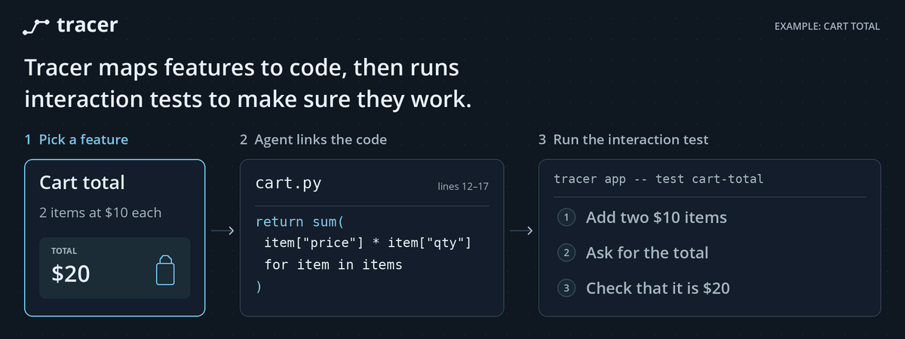

# Tracer CLI

**Know which CLI journeys and test steps are linked to a line of code, and which lines still need attention.**

Tracer is a local, dependency-free navigation tool for any Git repository. Connect source ranges to ordered CLI actions and optional test witnesses, look up those relationships in either direction, and catch links that go stale after edits.

**Manual links are not measured code coverage.** The manual map never runs its described actions or claims a test executed a line. Optional LCOV imports keep measured interval evidence separate. The animation above is an illustrated workflow, using generated artwork, not an execution recording.

[Report performance measurements](docs/performance.md) describe the shared JavaScript implementation. From 0.2.0, [manual counts skip whitespace-only blank lines](docs/blank-lines.md); unmarked comments remain counted. [Agents can explicitly mark comment-only ranges](docs/comments.md), without a parser or extra audit workflow.

## Import measured interval evidence

If your app can export cumulative LCOV snapshots, connect an actual action sequence to the line counters that increased during its interval:

```sh
tracer measure import --before before.lcov --after after.lcov \
  --manifest interval.json --sources build-sources.json --strip-prefix /capture/
tracer measure report --action 'app select --index 1'
tracer measure report --source src/app.py:12 --json
tracer measure check
```

The required manifest pins the run, application build, probe, tools, exact exports and capture-time source manifest. It preserves tool-hash timing and missing hashes explicitly. The source manifest must come from the recorded build, not a hash of today's files invented after the fact. See [the measured-evidence guide and complete schema](docs/measured.md).

An increase means **observed during the whole interval**, not caused by each listed action. Background activity and snapshot work can overlap. Zero deltas are retained but not counted as observed. Only matching instrumented `DA` line records form this denominator; missing lines are unknown. Changed source becomes stale and contributes zero current observations. Import normally rejects stale source; explicit `--allow-stale` preserves a historical interval without rebinding it to changed code. Measured evidence never alters the manual map or its minimum gate.

## Install

Requires **Node.js 20+** and **Git**. macOS, Linux, and other Node/Git environments are supported. The repository is the distribution source; this package has not been published to npm.

```sh
git clone https://github.com/pcopu/tracerCLI.git
cd tracerCLI
npm run check
npm install --global .
tracer --version
```

Both `tracer` and `tracercli` invoke the same CLI. If your npm global prefix needs administrator access, use a user-owned prefix rather than `sudo`:

```sh
npm install --global --prefix "$HOME/.local" .
export PATH="$HOME/.local/bin:$PATH"
```

Or run without installing: `node /path/to/tracerCLI/bin/tracer.mjs --root /path/to/your/repo report`.

## Initialize a project and connect its CLI

An application CLI lets agents and tests operate the app through commands. Before coverage work, audit the app's features and build or extend its CLI to expose every authorized feature. If the app has no CLI, one must be built; Tracer does not create one automatically. The setup output explains this prerequisite and distinguishes a missing connection from an existing CLI whose feature parity has not been verified.

Inside an application's Git repository:

```sh
tracer init --app-json '["node","cli/app.mjs"]' \
  --actions-json '["actions","--json"]'
tracer actions
tracer app -- status --json
```

Use the app's actual executable and supported discovery arguments. `tracer init` with no app flags is also valid for mapping-only projects. It creates `tracer.json` and an empty link map if absent, preserves existing files, and never runs app code. Conflicting existing configuration fails instead of being overwritten. Project trace minimum remains in the link map.

If setup says no application CLI is connected, inspect the repository before deciding it needs a new one. Ask your agent to explain what must be connected or built and obtain any missing authorization. Once ready, explicitly review/edit an existing `tracer.json` to add its app arguments; `init --app-json` is for a new configuration or a matching existing one, not an overwrite. Keep the CLI, discovery/help and tests current whenever app features change. Preserve consent, authentication and safety checks, and report inaccessible or unimplemented routes rather than claiming full coverage. Read-only mapping inspection can continue while an app change is blocked.

`tracer actions` **executes** the configured discovery argv. Without an `actions` array, it invokes the app's `--help`; it never guesses another command after failure. `tracer app -- ...` explicitly runs the configured app, forwarding arguments literally without a shell, with the repository as cwd and inherited stdin/stdout/stderr. Exit codes and cancellation signals are propagated. Inspect and trust `tracer.json` before either command: executable configuration is code, not passive metadata. Mapping commands do not read or execute it.

For example, an app exposing only help can use `--actions-json '["--help"]'`. No generic `actions --json` capability is assumed, and connecting an app does not grant access to any account or authorize its consequential actions.

## Link code → actions → a test

Run these commands inside **your application's Git repository**. Substitute real source and test ranges from that repository; these example files are illustrative.

```sh
tracer link src/cart.py:10-18 \
  --action 'cart add --sku demo --quantity 2' \
  --action 'cart total' \
  --step tests/cart.spec:20-30 \
  --why 'Add two items, then assert the calculated total.'

tracer report --source src/cart.py:12
tracer report --action 'cart total'
tracer report --sequence '["cart add --sku demo --quantity 2","cart total"]'
tracer report --step tests/cart.spec:25
tracer check
```

Each action is a literal description, not shell input. Repeating `--action` preserves order and repeated actions. `--step` is optional: an action-only link remains visibly different from a link with a test witness. Neither is execution evidence.

## How many traces does each line have?

```sh
tracer config --minimum-traces 2
tracer report --source src/cart.py:10-18
tracer report --json
tracer check --require-minimum
```

A **distinct manual trace** means one exact ordered action sequence. Per-line counts deduplicate it across overlapping source links, copied entries, different IDs and different test witnesses. One sequence containing three repeated actions is still **one trace**, not three. Two witnesses for the same sequence also count once. Meaningful scenario variants need distinct action descriptions, such as different inputs or preconditions.

Reports show each line/range's trace count and the subset with a test witness. Project minimum defaults to 1 and may be set to any positive safe integer. Stale or invalid links count as zero. `check` validates link integrity; `check --require-minimum` also fails when source lines are below the project minimum. A one-off `--minimum-traces N` on `report` or threshold-enabled `check` does not change the saved minimum.

**These counts are declared associations.** Tracer cannot recognize semantic aliases, establish independent tests, or prove execution. Do not pad counts with differently worded copies of the same journey. Even every line meeting the minimum would not prove a test ran.

## Keep the map current

To keep scenario and test-only support code outside an application's manual mapping denominator, use [project mapping ignores](docs/ignores.md): `tracer ignore tests/ --why 'Test-only scenarios and fixtures.'`. Restore the exact path with `tracer unignore tests/`. Ignored scope is reported separately; its tests still run and all stored source/witness links remain integrity-checked. Ignoring is not measured coverage and does not remove code or links.

Tracer hashes the exact source and witness snippets. After changing, moving or deleting linked code or test steps:

1. Run `tracer check` and inspect each affected relationship.
2. Correct the code, CLI interaction and test as needed.
3. Remove the old link with `tracer unlink ID`, then add a reviewed link at the current ranges.
4. Run `tracer report` to find new and still-unlinked lines. Run the actual tests separately.

Hashes are never silently refreshed. The version-1 sidecar lives at `docs/testing/code-e2e-links.json`, compatible with the original prototype. Commit it with the code and tests it describes. Use `--map PATH` before the command for an alternative repository-relative location.

## Agent skill

The reusable [Tracer skill](skills/tracer/SKILL.md) requires agents to first audit and establish the complete authorized app CLI surface before new coverage/mapping work, then maintain CLI parity and links whenever app features change. If app changes are not authorized or a route is restricted, it requires explicit gaps rather than bypasses or claims of completion. It keeps manual mapping, CLI parity, real test results and measured coverage separate.

`tracer init` detects existing Codex/Claude configuration directories as a hint, not proof of agent availability. In an interactive terminal it asks before installing a missing skill, then asks separately before appending one short pointer to `AGENTS.md` or `CLAUDE.md`. In noninteractive use, no agent files change without explicit flags:

```sh
tracer init --agent codex --install-skill
# Separate approval for a generic project instruction:
tracer init --agent codex --add-instruction
```

Use `--agent claude` for Claude. Ambiguous or unsupported agents are not guessed. Existing skills and project text are preserved; installation never overwrites a customized skill. Installation alone does not authorize changing project instructions. The global skill location is `${CODEX_HOME:-$HOME/.codex}/skills/tracer` for Codex and `~/.claude/skills/tracer` for Claude.

Skill discovery depends on the agent. A new session or restart may be needed; existing agents are not guaranteed to hot-reload. You can explicitly ask: “Use the tracer skill to maintain the code-to-CLI-to-test map and show the gaps.”

## GitHub updates and skill refresh

Updates are opt-in and use only the official `pcopu/tracerCLI` GitHub repository. A normal npm install or Git checkout is never rewritten. To create a separate per-user managed installation:

```sh
tracer update --check
tracer update --install-managed
# Use the managed launcher for subsequent commands:
export PATH="$HOME/.local/share/tracer/bin:$PATH"
tracer update --auto apply
tracer update --status
```

Use `--commit FULL_40_CHARACTER_SHA` to install an explicitly reviewed commit, or `--version VERSION` for a stable release. The updater resolves official versions/main to an immutable commit, verifies downloaded Git blobs, stages files without running install scripts, and switches the managed pointer atomically. It retains a previous version for `tracer update --rollback`. This is official HTTPS provenance and content integrity, not an independent publisher signature.

Automatic mode is `off`, `check`, or `apply`. It runs at most daily after eligible successful CLI invocations, not as a background service. Read-only mapping reports/checks, CI, and `TRACER_NO_UPDATE=1` skip automatic update work. `apply` only changes managed installations. Turn it off with `tracer update --auto off`. The current command uses its already-loaded version; updated code runs on the next invocation.

Skills newly installed through Tracer are registered with their original checksum. Updates refresh unchanged registered skills, preserve local customizations and never rewrite project instructions. Existing unregistered skills remain untouched. An agent restart or new session may be needed to load a changed skill. See [update safety, limitations and recovery](docs/updates.md).

## Boundaries and documentation

- No runtime dependencies, telemetry, application hooks or language parsers. Explicit app forwarding is separate from mapping; optional GitHub updates are documented separately.
- Reads working-tree files, including tracked and nonignored untracked files. Included source totals include tests, tooling and unmarked comments unless explicitly ignored for project mapping scope; whitespace-only blanks and current declared comment ranges are excluded. Physical line numbers and exact byte hashes stay unchanged. See [blank-line counting](docs/blank-lines.md).
- Explicit source inventory and build/dependency exclusions. Add an unlisted language with `--include-ext .zig` before the command.
- Source lookup, reverse witness lookup, action and exact-sequence lookup; text and structured JSON reports.
- Symlink/path validation, atomic writes and an exclusive writer lock. Not a sandbox against concurrent hostile filesystem changes.
- [Complete guide and inventory rules](docs/guide.md)
- [Sidecar format and JSON report](docs/schema.md)

## Tracer tests itself

This repository has its own `tracer.json`, project CLI and reviewed source-to-journey map. Tests drive the actual public CLI through complete workflows, not implementation APIs:

```sh
node bin/tracer.mjs actions
node bin/tracer.mjs app -- test
node bin/tracer.mjs app -- test mapping
node bin/tracer.mjs app -- test project
node bin/tracer.mjs app -- test update
node bin/tracer.mjs check
node bin/tracer.mjs report --source src/tracer.mjs
```

`npm test` is the self-hosted `tracer app -- test` entry point. `npm run check` adds syntax validation and map integrity. Journeys use disposable Git repositories, fake homes, real subprocesses and synthetic GitHub responses. They exercise mapping/recovery, deduplicated counts, inventory/bytes/path safety, app cancellation, separate setup consents, update integrity and rollback. They never call production implementation APIs to simulate success.

The committed map links reviewed implementation ranges to actual CLI interaction sequences and exact journey assertions. [Descriptor conventions](docs/self-hosting.md) explain fixture placeholders and argv quoting. It is not a blanket link to the test runner or a measured execution report. Physical links and trace counts remain visible, including blanks; manual totals use nonblank lines. Source changes require re-reviewing the affected links before relinking, not auto-refreshing hashes.

```sh
npm run check
npm pack --dry-run
```

No GitHub Actions configuration is required or installed.

### Progress and dead-code review

`tracer report` and `tracer report --json` separately show feature categorization, manual scenario mapping, and mapping with a current test witness. Percentages divide unique included nonblank lines by the report's included scope, excluding blank lines and currently declared comments. Filtered reports describe the selected scope. An empty denominator is N/A. A witness is a source-to-test link, not evidence that the test ran or passed; use measured evidence separately.

If `docs/testing/code-feature-catalog.json` exists, Tracer reads its version-1 feature-classification catalog, including the format used by Scriv. Current, well-formed model-proposed ranges count once; Tracer checks file and span hashes and reports stale, malformed or overlapping entries. A missing or unreadable catalog is shown as unavailable, not as complete. These classifications are proposals, not verified feature labels or scenario links. Tracer never imports them into the v1 link map or updates their hashes.

Mark a suspected dead-code range with `tracer dead-code src/example.js:10-15 --why 'candidate for removal' --evidence 'reviewed callers and target membership'`. This is a review declaration, not proof the code is unreachable. `tracer report` shows its unique included lines as a percentage of the **whole** included inventory, even when a lookup filter is active. Overlaps count once; ignored files and declared comments do not contribute. Marks do not delete or change the mapping denominator. `tracer undead-code ID` removes only the declaration. The reason, evidence, snippet hash and whole-file hash are retained; after any file edit, review and remove/recreate the stale mark instead of refreshing it blindly. `tracer check` reports stale or invalid marks.

## Reusable named scenario steps

Expose each step's actions, preconditions, expected results and relevant code once, then compose broad scenarios from stable IDs. `tracer scenario prepare|check|report|packet` pins and reviews the catalog; `tracer scenario link --reviewed` applies a hash-pinned atomic batch without changing the version-1 map format. The optional `@pcopu/tracercli/scenario-runtime` helper records explicit action and assertion callbacks separately during the real application scenario. It never executes stored action descriptions or turns a successful command into an asserted result.

Read [Reusable scenario steps](docs/scenarios.md) for the schema, workflow, runtime integration and evidence limits. Manual associations, adapter-reported assertions and measured execution remain separate.

## Propose first, audit afterward

For whole-codebase mapping, author the full [proposed scenario map](docs/proposals.md) first, including unwritten tests and explicit uncertainty. `tracer proposal prepare/check/report` pins and reports the separate plan without app execution or reviewed-link promotion. `tracer proposal audit --file docs/testing/proposed-scenario-map.json --offset 0 --limit 25` provides later bounded audit packets. `tracer report --json` keeps proposed, operator-declared reviewed links and execution status separate; unknown execution stays null rather than becoming a false percentage.

## Audit alongside active coding

Author scenario contracts with feature changes, then use the [supervised audit queue](docs/audit-queue.md) to freeze small source/contract snapshots for independent review while coding continues. The CLI persists bounded jobs, claims and per-assertion receipts; it does not launch reviewers or execute tests. `tracer audit drain --file docs/testing/proposed-scenario-map.json` fails for unfinished, stale or unresolved current obligations. Semantic acceptance, executable readiness and actual execution stay separate.
